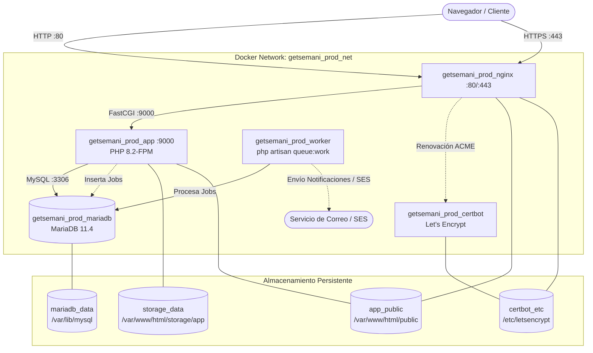

# Bitácora de Defensa — P21: Dockerización de Producción

## 1. Objetivo de la Tarea

Configurar y estructurar la arquitectura de contenedores Docker para el despliegue de producción del Sistema de Finanzas e Inventario de la Iglesia Getsemaní, cumpliendo con los estándares de **ARQUITECTURA_FASE3.md (§6)** y la rúbrica de calificación.

El diseño desacopla los servicios en contenedores independientes (PHP 8.2-FPM, Nginx Reverse Proxy con SSL/Certbot, MariaDB 11.4 oficial y Worker de colas en segundo plano), aplicando optimizaciones de rendimiento (OPcache, Vite precompilado sin `node_modules`) y aislamiento estricto de seguridad.

---

## 2. Arquitectura de Contenedores y Flujo de Peticiones

### Flujo de una petición típica en producción:

1. **Recepción TLS/HTTP**: El cliente solicita `https://tudominio.com/ingresos`. La petición llega a `getsemani_prod_nginx` en el puerto 443. Si entra por el puerto 80, Nginx devuelve una redirección permanente `301 Moved Permanently` hacia HTTPS (salvo rutas `/.well-known/acme-challenge/`).
2. **Archivos estáticos vs dinámicos**: Nginx evalúa la ruta (`try_files $uri $uri/ /index.php?$query_string;`). Si es un recurso estático precompilado (CSS, JS de Vite, imágenes), Nginx lo despacha directamente desde el volumen `app_public` con compresión Gzip.
3. **Petición PHP FastCGI**: Si la ruta es dinámica, Nginx pasa la solicitud vía socket TCP interno a `app:9000` (`fastcgi_pass app:9000`).
4. **Ejecución en PHP 8.2-FPM**: El contenedor `getsemani_prod_app` ejecuta el ciclo de vida de Laravel con OPcache activo (`opcache.validate_timestamps=0`).
5. **Base de Datos aislada**: La consulta SQL viaja a `getsemani_prod_mariadb:3306` dentro de la red privada `getsemani_prod_net`. El puerto 3306 **no está expuesto** al host, previniendo accesos externos directos.
6. **Procesamiento Asíncrono (Worker)**: Si la acción genera un correo (2FA, comprobante PDF de donación), Laravel encola la tarea en la tabla `jobs` (`QUEUE_CONNECTION=database`). El servicio `getsemani_prod_worker` (`php artisan queue:work --tries=3`) toma el trabajo en segundo plano y realiza el envío sin bloquear la respuesta HTTP al usuario.

---

## 3. Decisiones Técnicas y Reglas Implementadas

1. **Multi-Stage Build en `docker/app/Dockerfile`**:
   - **Etapa 1 (`assets_builder`)**: Imagen Node.js 20 que ejecuta `npm ci && npm run build` para compilar los assets de Vite/Tailwind.
   - **Etapa 2 (`vendor_builder`)**: Imagen Composer 2 que instala las dependencias de producción (`composer install --no-dev --optimize-autoloader --classmap-authoritative`).
   - **Etapa 3 (Runtime)**: Imagen PHP 8.2-FPM Alpine ligera donde solo se copian `public/build` y `vendor/`, garantizando que `node_modules`, pruebas y herramientas dev **no existan** en la imagen final de producción.
2. **Nginx con Soporte Let's Encrypt y Fallback**:
   - Plantilla `docker/nginx/default.conf.template` con bloques 80 (redirección) y 443 (SSL).
   - Script `docker/nginx/ssl-setup.sh` que genera un certificado autofirmado inicial si no existe uno de Let's Encrypt para evitar que Nginx falle al levantar en frío.
   - Filtro `NGINX_ENVSUBST_FILTER="DOMAIN"` para no corromper variables de Nginx (`$host`, `$uri`, etc.).
3. **Cero Secretos y Prohibición de Datos Demo**:
   - `docker-compose.prod.yml` no contiene contraseñas en duro ni define `SEED_DEMO=true`.
   - `.env.prod.example` sirve como referencia documentada. `.env.prod` está explícitamente ignorado en `.gitignore`.
4. **Worker Supervisado y Alta Disponibilidad**:
   - El contenedor `worker` utiliza la política `restart: unless-stopped`, reintentos `--tries=3` y depende de que tanto `mariadb` como `app` hayan superado sus respectivos `healthcheck`.
5. **Entrypoint de Producción (`scripts/entrypoint.sh`)**:
   - Asegura la creación de directorios y permisos `www-data` para `storage/` y `bootstrap/cache`.
   - Soporta lectura de secretos en runtime desde AWS SSM Parameter Store (`/getsemani/*`) si existe rol IAM, o fallback a `.env.prod`.
   - Ejecuta `php artisan config:cache`, `route:cache` y `view:cache` antes de iniciar el comando.

---

## 4. Preguntas para el Evaluador con Respuestas

### Pregunta 1: ¿Por qué utilizó un build multi-stage en el Dockerfile de la aplicación y qué ventajas aporta a la seguridad y al tamaño de la imagen?
> **Respuesta**:
> En `docker/app/Dockerfile` se dividió la construcción en 3 etapas: `assets_builder` (Node 20), `vendor_builder` (Composer 2) y la imagen final (`php:8.2-fpm-alpine`). Esto asegura que herramientas pesadas del build (como el runtime de Node.js, npm y la carpeta entera `node_modules` de más de 200 MB, así como dependencias PHP de testing como PHPUnit o Mockery) se descarten por completo. En la imagen final solo se transfieren los artefactos compilados (`public/build`) y las clases de producción optimizadas (`vendor`), reduciendo radicalmente la superficie de ataque (vulnerabilidades en paquetes dev) y optimizando el consumo de disco y memoria del servidor.

### Pregunta 2: ¿Cómo se garantiza que el servicio de base de datos MariaDB no quede expuesto a ataques desde Internet y cómo se persisten sus datos?
> **Respuesta**:
> En `docker-compose.prod.yml`, el servicio `mariadb` no define la sección `ports:`, lo que significa que el puerto 3306 **no se enlaza al host ni a la interfaz pública del servidor**. La comunicación con la base de datos se realiza de forma exclusiva dentro de la red interna de Docker `getsemani_prod_net`, a la cual solo pertenecen `app` y `worker`. Además, para garantizar que los datos no se pierdan al reiniciar o actualizar los contenedores, se utiliza el volumen nombrado `mariadb_data` mapeado a `/var/lib/mysql`.

### Pregunta 3: ¿Por qué en producción se utiliza un contenedor separado para el worker de colas (`php artisan queue:work`) en lugar de mantener `QUEUE_CONNECTION=sync`?
> **Respuesta**:
> Conforme a la regla de diseño D3-04 y la rúbrica de Fase 3, en producción el envío de notificaciones por correo (como códigos 2FA de recuperación y comprobantes de donación en PDF) involucra latencia de red contra servidores de correo (como AWS SES o SMTP). Si mantuviéramos `sync`, la petición HTTP del usuario se congelaría durante varios segundos mientras se genera el PDF y se entrega el correo, degradando la experiencia o agotando el tiempo de respuesta de FastCGI/Nginx. Al configurar `QUEUE_CONNECTION=database` y un servicio `worker` con `restart: unless-stopped` en `docker-compose.prod.yml`, la respuesta al usuario es instantánea (< 100 ms) y el worker procesa el correo de forma asíncrona y tolerante a fallos (`--tries=3`).
