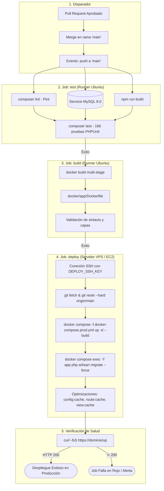

# Bitácora de Defensa — P22: Pipeline de CI/CD de Despliegue Continuo

## 1. Objetivo de la Tarea

Implementar un flujo de Integración y Despliegue Continuo (CI/CD) automatizado y seguro mediante GitHub Actions (`.github/workflows/deploy.yml`), conforme a las especificaciones de **ARQUITECTURA_FASE3.md (§7)** y la rúbrica de evaluación (100 pts).

El pipeline garantiza que ningún cambio llegue a producción sin haber superado previamente la suite completa de pruebas unitarias/funcionales y el linter, valida la construcción de la imagen de producción en Docker, ejecuta el despliegue mediante SSH y aplica migraciones de base de datos de manera atómica, concluyendo con una validación de salud HTTP 200 en `/up`.

---

## 2. Flujo Completo del Pipeline

---

## 3. Decisiones Técnicas y Medidas de Seguridad

1. **Disparo Exclusivo en `main`**:
   - El workflow `.github/workflows/deploy.yml` únicamente escucha `on: push: branches: [main]`. No se ejecuta en `develop` ni en ramas `feature/*` (las cuales son validadas por `ci.yml`).
2. **Encadenamiento Estricto de Jobs (`needs: [test]`, `needs: [build]`)**:
   - Si una sola prueba falla o si `Pint` detecta desvíos de formato PSR-12, los jobs `build` y `deploy` son cancelados inmediatamente, protegiendo el entorno productivo de código roto o inestable.
3. **Cero Secretos de Base de Datos en GitHub**:
   - En cumplimiento estricto con las reglas de oro de `AGENTS.md`, las credenciales de base de datos (`DB_PASSWORD`), la llave de cifrado `APP_KEY` y las contraseñas de administrador no residen como secretos de GitHub Actions. Estas se cargan en el servidor en tiempo de ejecución (`.env.prod` seguro o AWS SSM Parameter Store).
4. **Mínimo Privilegio en el Despliegue (SSH + OIDC)**:
   - El despliegue se efectúa usando una llave privada SSH dedicada (`DEPLOY_SSH_KEY`) restringida al host de despliegue (`DEPLOY_HOST`). Si se interactúa con AWS, se utiliza autenticación OIDC mediante `aws-actions/configure-aws-credentials@v4` con tokens efímeros sin llaves de acceso estáticas.
5. **Migraciones con `--force` Posteriores al Levantamiento**:
   - Las migraciones (`php artisan migrate --force`) se ejecutan dentro del contenedor `app` una vez que los servicios están activos y saludables, garantizando que la base de datos coincida con la versión del código desplegada.
6. **Sondeo de Salud HTTP en `/up`**:
   - La etapa final realiza peticiones sondeo con reintentos hacia el endpoint nativo `/up` de Laravel 11/12. Si el servicio devuelve códigos 500, tiempos de espera o errores de conexión, el job finaliza en estado fallido (`exit 1`).

---

## 4. Preguntas para el Evaluador con Respuestas

### Pregunta 1: ¿Por qué el pipeline se divide en tres jobs separados (`test`, `build`, `deploy`) en lugar de ejecutar todo en un único script secuencial?
> **Respuesta**:
> La separación modular en jobs con dependencias (`needs: test`, `needs: build`) implementa el principio de "Fail-Fast" y aislamiento de entornos:
> 1. Si el código no pasa las pruebas contables o de seguridad en `test`, se aborta el flujo antes de gastar recursos computacionales en compilar imágenes Docker o abrir túneles SSH al servidor de producción.
> 2. El job `build` valida que los artefactos de producción y el Dockerfile multi-stage compilen limpiamente sin depender de la red del servidor final.
> 3. El runner de GitHub Actions que ejecuta `deploy` únicamente requiere acceso de red al puerto SSH del servidor, manteniendo el proceso desacoplado y auditable paso a paso en la consola de GitHub.

### Pregunta 2: ¿Cómo se maneja la seguridad de los secretos y qué credenciales se almacenan en GitHub Actions frente a las que se manejan en el servidor?
> **Respuesta**:
> En GitHub Actions únicamente se almacenan secretos de transporte e infraestructura: `DEPLOY_HOST`, `DEPLOY_USER`, `DEPLOY_SSH_KEY` y opcionalmente `AWS_ROLE_ARN`.
> **Ninguna credencial de aplicación** (como `APP_KEY`, contraseñas de MariaDB, tokens de sesión o claves de correo SES) se almacena en GitHub. Esas credenciales residen exclusivamente en el servidor productivo (en un `.env.prod` con permisos `0600` o en AWS SSM Parameter Store), de donde el script de inicio `scripts/entrypoint.sh` las inyecta en runtime al arrancar los contenedores. Esto evita que administradores o colaboradores con acceso al repositorio puedan leer las contraseñas reales de producción.

### Pregunta 3: ¿Qué función cumple la verificación final contra `/up` y qué sucede si la aplicación no responde HTTP 200 tras el despliegue?
> **Respuesta**:
> En Laravel 11/12, la ruta `/up` (configurada en `bootstrap/app.php`) actúa como un endpoint de diagnóstico rápido (healthcheck) que verifica que el kernel HTTP, el framework y sus dependencias críticas se encuentran operativos. En `.github/workflows/deploy.yml`, el paso final ejecuta `curl -fsS ... https://${DEPLOY_HOST}/up`. Si la base de datos no pudo conectarse, los permisos de almacenamiento fallaron o Nginx no puede comunicarse con PHP-FPM, el sondeo no recibirá un código 200 y el job fallará inmediatamente (`exit 1`), marcando el commit con una cruz roja en GitHub y notificando al desarrollador para que inspeccione los logs del servidor.
